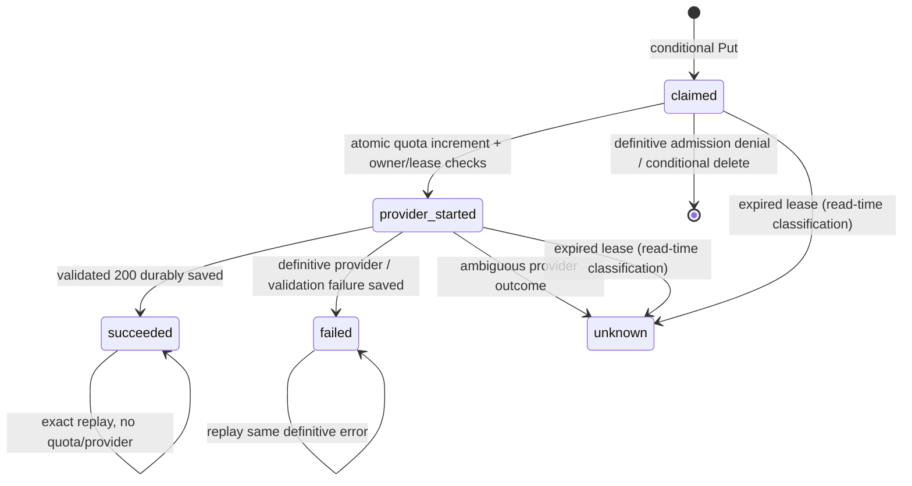

# AI generation request idempotency

## Scope and invariant

This is backend provider-request idempotency, separate from sync delivery and deck-save identity.
Within the 24-hour supported retry window, an authenticated Cognito sub plus request UUID has
one durable owner and at most one authoritative provider execution/result. Same-key replay,
in-progress duplicates and conflicts add no provider execution, daily quota unit or usage charge.
The replay is the exact validated HTTP application body, including original timestamps/usage.

Implementation is repository-only until explicitly deployed and activated. Committed mode is
`legacy`; live backend behavior is not changed by landing code or sending new client fields.
Production is not instantiated or enabled. No deployment or real provider call was performed.

## Preflight

Mobile sends `POST /ai/generate-study-deck` with `{ request, context }`. `request` contains source
identity/title, normalization/contract versions, selected chunk IDs, card ceiling/floor, options
and optional language. `context` contains ordered normalized chunks, bounded text and coverage
metadata. The server recomputes text size and checks selection consistency before admission.

Previously no provider request identity existed. `generationAttemptId.ts` supplied a Math.random
correlation token for a user-facing review session, not a backend key. Mobile fetch had no retry
loop. Backend admission conditionally acquired `LEASE` in the AI rate-limit table, then atomically
incremented the UTC-day quota bucket, before the provider adapter ran. Provider failures after
admission consumed quota. The one-slot lease stopped overlap but could not replay a lost result.
The final retry audit found its explicit `maxAttempts: 2` could resend ambiguous requests;
this is now reduced to `maxAttempts: 1` for the generation client only.

The rate-limit table contains quota and lease records only. A dedicated table keeps temporary
generated responses out of metering storage and avoids broadening its data access permissions.

## Attempt and request identities

Contract v1 adds optional UUID fields inside `request`:

```json
{ "request": { "generationAttemptId": "<UUIDv4>", "requestId": "<UUIDv4>", "...": "existing fields" }, "context": { "...": "existing context" } }
```

One user-facing run has one `generationAttemptId`, reused by every batch and the review session.
Every logical provider request has a distinct `requestId`. Single generation gets one; multi-batch
preallocates one per planned step before dispatch. These use the existing Expo native OS UUIDv4
bridge (`globalThis.expo.uuidv4`) or Web Crypto in Node/browser, with no Math.random fallback and
no new dependency. Missing secure randomness fails closed. IDs contain no source/account content.

A retained low-level retry reuses the same prepared request/body, or explicitly passes the same
`generationAttemptId` and `requestId` into `generateStudyDeck`. Calling it without retained IDs
means a new logical request. There is no automatic HTTP retry, polling, or resumable batch loop.
User Retry in the current setup screen is a full restart: new attempt and all-new request IDs.
Cancellation invalidates UI publication but cannot stop a provider call; its successful result
may still be cached. Same-key replay can retrieve that result, but ordinary full restart does not.

Backend validates lowercase UUIDv4 format, type and exact length for supplied IDs, even in legacy
mode; required mode also rejects a missing request ID. Authenticated sub comes exclusively from
the trusted authorizer context. Request/body account fields cannot select a partition.

## Storage and state machine

`interval-dev-ai-request-idempotency` / `interval-staging-ai-request-idempotency`:

- `PK = U#<authenticated sub>`, `SK = R#<requestId>`.
- `status`, random execution `owner`, SHA-256 `fingerprint`, optional attempt UUID.
- Epoch timestamps `createdAt`, `updatedAt`, `leaseExpiresAt`, `expiresAt`, native TTL `ttl`.
- `quotaCharged` after atomic admission.
- On definitive completion, `responseStatus` and the serialized validated `responseBody` only.
  Cards are not stored a second time in separate fields. Original token usage/latency is in body.



Lease is 60 seconds, longer than the existing 28-second Lambda timeout. There is **no automatic
reclaim**, including an expired claimed state: this deliberately favors safety over availability.
A pre-provider request that is definitively denied removes only its own still-claimed record.
An ambiguous claim/transaction/owner state is never blindly deleted or reused to execute again.
No Lambda wait loop polls for another invocation to finish.

## Ordering and atomicity

1. Authenticate and validate the existing request plus UUIDs. Malformed/auth failures create no
   records and use no quota.
2. In keyed optional/required mode, fingerprint and conditionally Put a new claim. A losing Put
   performs a strongly consistent point Get before checking expiry/state.
3. Different fingerprint returns 409 `idempotency-conflict`. Live claimed/started record returns
   409 `request-in-progress` with `retryable: true`. Expired/unknown returns 503
   `request-outcome-unknown`; succeeded/failed replays the saved body/status. These paths do not
   acquire a concurrency lease, consume quota, or execute the provider.
4. A new owner checks provider configuration and acquires the existing user's one concurrency
   lease. A different request retains normal `generation-in-progress` rejection; its unstarted
   claim is conditionally released.
5. One DynamoDB `TransactWriteItems` atomically increments the current UTC-day quota bucket
   under the existing **20/day** condition, sets `provider_started`/`quotaCharged`, and checks
   request ownership/claim lease plus the existing concurrency lease token/expiry. Its SDK
   `ClientRequestToken` is the owner UUID, preventing SDK-level duplicate transaction effects.
6. Only confirmed transaction success reaches the existing provider adapter/response validation.
7. A conditional owner/state update persists the complete bounded response before returning
   success. The concurrency lease is released in finally, including failure paths.

The transaction uses the same central quota limit and quota-row TTL as legacy admission; it does
not reserve additional allowance, refund, increase limits, or weaken concurrency. A definitive
quota denial leaves no started marker and no increment. A transport error after transaction
commit is conservatively unknown: quota can have been charged while provider execution never
started. That crash/admission gap cannot be eliminated by independently updating the two items.
We intentionally do not retry provider execution to make the UI appear recovered.

DynamoDB transaction authorization uses underlying item actions plus `ConditionCheckItem`, as
specified by [AWS transaction IAM documentation](https://docs.aws.amazon.com/amazondynamodb/latest/developerguide/transaction-apis-iam.html).
The transaction token's native deduplication period is ten minutes, separate from application
retention ([TransactWriteItems](https://docs.aws.amazon.com/amazondynamodb/latest/APIReference/API_TransactWriteItems.html)).

## Fingerprints

The server SHA-256 hashes deterministic recursively key-sorted serialization of request semantics,
ordered context and server model identity. All request fields except the two correlation UUIDs
are included, including source identity/title, versions, selected IDs, card ceiling/floor, options
and language. Context includes the ordered supplied text and metadata. Array order is preserved;
object key insertion order is irrelevant. Auth tokens, headers and network metadata are excluded.
Only the digest is stored, never the canonical input/source text or prompt. Including additional
context metadata is deliberately conservative: changed semantics must conflict, not double-run.
Changing server model configuration also conflicts rather than replaying under new semantics.

## Failure and ambiguity

- Unauthorized, malformed or missing required key: no record/quota/provider.
- Provider not configured: own unstarted claim removed, no quota/provider.
- Generic concurrency/daily denial: own unstarted claim removed; no additional quota/provider.
- Claim/read storage failure: 503 `idempotency-storage-failure`; no provider dispatch.
- Transaction acknowledgement unknown: 503 `request-outcome-unknown`; never dispatch blindly.
- Provider throttle/definitive invalid output: cache the safe failure status/body. Same key cannot
  re-execute; an explicit new logical request is needed after recovery.
- Provider timeout/unavailable/throw: outcome unknown, same key cannot re-execute. A started
  marker remains protective even if saving unknown state fails.
- Provider succeeds but response persistence fails or its acknowledgement is lost: report unknown.
  If the write actually committed, a subsequent same-key read replays it; otherwise the started
  marker blocks reinvocation after lease expiry. No false replay-safe success is returned.
- Client transport loss, unreadable success or unclassified gateway 5xx on a keyed request:
  mobile reports an unknown outcome. No transport retry loop is added. Specific safe backend
  categories are preserved instead of exposing raw errors.

This is not distributed exactly-once execution of an external model. The durable marker precedes
actual provider dispatch, so a crash there can charge quota without a usable result. The
production Bedrock client now enforces `maxAttempts: 1`: one explicit application provider call
performs at most one SDK HTTP invocation attempt. This path uses `ConverseCommand`, not
`InvokeModelCommand`. No application, Lambda helper, Bedrock wrapper or mobile fetch retry loop
exists. DynamoDB SDK retries remain separate: the admission transaction has its owner UUID token,
and conditional writes/unknown-outcome handling fence uncertain storage acknowledgements.
No automatic lease recovery, partial-deck save, background execution, billing, queue or batch
resume was added.

### Provider execution, transport attempt and model execution

- An application provider execution is one admitted call through the provider adapter; the quota
  and `providerExecutionCount` describe this level, not SDK transport attempts.
- An SDK transport attempt is a request dispatched to the Bedrock HTTP handler. The former
  `maxAttempts: 2` meant up to two total attempts, including the initial request. A reset/timeout
  or retryable 5xx could trigger a second attempt after the first had reached the service. This
  weakened the cost goal even though only one result could become authoritative.
- Actual model execution is service-side work. A pre-dispatch failure can mean zero executions;
  an ambiguous dispatched attempt may have executed despite a missing response. Neither a
  client counter nor an error proves whether Bedrock ran or charged. One SDK attempt prevents
  our middleware from resending, but is not proof of distributed exactly-once service execution.

With activated keyed admission, the honest guarantee within retention is: one durable owner,
at most one application provider execution, at most one explicit Bedrock SDK invocation attempt,
and at most one authoritative cached response/quota charge for that key. Unknown outcomes never
silently resend. Full restart creates a new key and can execute/charge again; legacy mode still
lacks cross-HTTP-request deduplication. Disabling SDK retry applies in legacy mode too.
Throttling stays categorized `rate-limited`; transport errors/timeouts follow existing category
mapping and become conservative unknown outcomes in the keyed envelope. Evaluation never treats
SDK attempts as extra application executions. The tests use the real SDK with fake HTTP handlers.
See [AWS retry semantics](https://docs.aws.amazon.com/sdkref/latest/guide/feature-retry-behavior.html)
for the definition of maximum attempts (initial request included).

## Privacy, retention and size

Exact replay requires enough authoritative content to return the result. Memory-only cache cannot
survive a lost response or Lambda restart. The privacy decision is therefore to cache only the
validated API result temporarily: generated title/cards and their response metadata, original
usage/latency. No source text, prompt, filename field, auth token or separate card collection is
stored in the idempotency table. Logs contain safe categories, UUID correlation IDs and aggregate counts, never cached
bodies, source/card text or raw provider/storage errors.

Retry eligibility expires **24 hours from initial claim**, not extended by reads/replay. This
covers realistic same-session/short reconnection retries. The server refuses expired content even
before cleanup. IDs must never be deliberately reused; callers must not replay old requests after
this supported window. Once native TTL eventually deletes a record, the server has no permanent
tombstone to recognize that old UUID. Guarantees are bounded by retention, not a claim of lifetime
exactly-once identity. Full restart always uses new UUIDs.

Native DynamoDB TTL is asynchronous and physical deletion can lag expiry by days, per
[AWS TTL documentation](https://docs.aws.amazon.com/amazondynamodb/latest/developerguide/TTL.html).
This is not an exact 24-hour erasure guarantee. The dedicated PAY_PER_REQUEST table uses AWS-managed
encryption and PITR disabled, matching existing ephemeral-table standards and avoiding backups
that retain generated content beyond intended cleanup. Existing environment removal policies
apply. IAM grants point Get/Put/Update/Delete on this table and existing rate-table item actions
plus a lease ConditionCheck; no Scan/Query or unrelated-table access is added. A production privacy
policy/strict erasure deadline would require a separate retention design before rollout there.

Serialized response body is capped at **256 KiB**, leaving margin under DynamoDB's item limit.
Typical bounded cards fit well below it; malformed huge IDs/metadata can still make a response
large. Oversize results remain unknown after provider execution; no cards are silently truncated
or sent as replay-safe success. Authenticated requests still incur normal quota/concurrency checks
for unique keys; TTL bounds retention, not request-rate costs. Existing API abuse controls remain.

## Client and evaluation semantics

New safe error categories map to understandable copy in all 13 locales; UI never says “idempotency.”
Unknown-outcome copy warns that starting over can use another daily request. Cached application
payload stays identical. Transport headers `x-interval-idempotency-replay` and
`x-interval-provider-executions` distinguish replay (true/0) from first completion (false/1).
These are optional performance metadata, not saved generation/card/provenance fields.

`providerExecutionCount` flows through the provider/domain outcome and multi-batch aggregation into
evaluation JSON. It counts new admitted executions reported by completed successful HTTP responses;
replay contributes zero. Missing/legacy information remains undefined, never inferred from HTTP
attempts or the preflight planned-request count. Error/lost-response executions may be unobserved;
this is not a complete account billing meter. Token usage on replay describes the original cached
result, not newly spent tokens. Planned request estimates remain estimates. Mock evaluation stays
deterministic and never calls a live provider. No source/card text is added to telemetry.

## Rollout and environment gating

Modes are independently configured through CDK context `developmentAiIdempotencyMode` /
`stagingAiIdempotencyMode`, persisted as `legacy` in `infra/cdk.json`. Runtime environment is
`AI_IDEMPOTENCY_MODE`, table name `AI_IDEMPOTENCY_TABLE`.

- `legacy`: existing backend admission behavior, IDs tolerated/validated but no replay guarantee.
- `optional`: keyed requests use durable idempotency; old keyless clients keep legacy admission.
- `required`: no provider request without a valid UUID. An invalid mode fails closed to required.

Safe Development sequence, **only after explicit deployment approval**:

1. Build/synth and review the table, IAM and bundled Lambda together. Provision via the existing
   Development stack using `-c developmentAiIdempotencyMode=optional`. Table/environment/IAM/code
   deploy together; there is no unsupported “infra only” deployment step. Persist optional in
   cdk.json once deployed so future plain deployments do not silently disable it.
2. Release/test the client that sends both UUIDs. New client → old backend remains contract-v1
   compatible but has no replay guarantee; new backend optional → old client remains compatible.
3. Verify exact replay, conflicts, quota and lease behavior. Move to required with
   `-c developmentAiIdempotencyMode=required`, then persist required in cdk.json after verification.
   Old clients are intentionally refused only at this explicit final migration step.
4. Do not roll back to legacy while protected in-flight operations exist; rollback needs an
   operational pause/drain longer than the Lambda/lease window and explicit acceptance that old
   clients lose replay protection. Never delete the table to recover an ambiguous request.

Staging receives the storage declaration, but its app still calls the **local mock provider** and
this repository still has no Staging AI HTTP Lambda/route. Setting its context mode does not
create one or enable real AI. Backend idempotency is provider-neutral and covered with injected
mock providers/fake HTTP in tests. Live Staging HTTP replay QA requires a separately approved mock
endpoint rollout; it cannot be claimed from the current local mock UI. Production remains absent.

## Validation and Founder QA

`npm run test:idempotency` covers durable claims, concurrent duplicates, exact replay, conflicts,
user isolation, canonicalization, malformed IDs, quota sequences/denial, leases/expiry, transaction
and finalization ambiguity, response bounds, logging, client IDs/cancel/restart, secure randomness,
safe errors, evaluation replay counts, real-SDK/fake-transport retry limits and the flagship
three-batch case. All storage/provider/HTTP
calls are fake. No test invokes real Bedrock. The same cases run under `test:ai`; evaluation tests
remain under `test:eval`. Tests do not replace eventual DynamoDB/device integration QA.

After eventual approved Development optional/required deployment:

A. Generate normally. Verify first successful response has execution header 1, one quota increment,
   and a succeeded point record before HTTP success. Test first-use consent and all card tiers.
B. Replay the exact same synthetic request body. Compare saved response files locally: body must
   be byte-identical, replay header true/executions 0, no additional provider log or quota unit.
C. Send two same-key requests concurrently. One executes; the other returns request-in-progress
   or a completed replay, never a second provider execution. A different key retains concurrency.
D. Alter context text/difficulty with the same key. Expect conflict and no quota change. Repeat
   under a second authenticated account: it must not receive the first account's cached result.
E. Multi-batch: verify distinct per-step IDs and one attempt ID. Use the deterministic flagship
   test for A / B lost / B replay / C: four HTTP attempts, exactly three provider executions/quota.
F. Verify daily limit still denies new keys, while a succeeded replay remains free even at the cap
   or after the UTC-day reset within its retry window.
G. Cancel mid-step, allow backend completion, then restart. UI discards the canceled draft;
   restart has a new attempt/request set and can consume quota again.
H. Simulate lost network/provider timeout and persistence failure with the deterministic tests;
   on device use a controlled network interruption. No partial save or blind same-key reexecution.
I. Run Staging local mock UI regression and `test:idempotency`'s mock HTTP replay. Do not claim
   live Staging HTTP replay or enable a real Staging provider; no such endpoint exists yet.
J. Inspect CloudWatch category/count logs only. Never log/screenshot tokens, request source text,
   cached response bodies or cards. Point-read DDB using the known authenticated partition/key;
   no scans or full result dumps are needed.

Safe local curl pattern (synthetic payload; token entered privately, never pasted into chat):

```sh
# Obtain your Development access token through the existing auth workflow first.
# Avoid shell tracing, terminal recording and screenshots while entering credentials.
umask 077
interval_auth_config=$(mktemp)
interval_result_a=$(mktemp)
interval_result_b=$(mktemp)
interval_request_file=$(mktemp)
trap 'rm -f "$interval_auth_config" "$interval_result_a" "$interval_result_b" "$interval_request_file"; unset interval_access_token' EXIT
read -r -s interval_access_token
printf 'header = "Authorization: Bearer %s"\n' "$interval_access_token" > "$interval_auth_config"
unset interval_access_token
node --input-type=module - "$interval_request_file" <<'JS'
import { randomUUID } from 'node:crypto';
import { writeFileSync } from 'node:fs';
const text = 'Leaves absorb sunlight. Roots take up water. Stems support leaves. Seeds can grow into new plants.';
const request = { generationAttemptId: randomUUID(), requestId: randomUUID(), sourceId: 'qa-synthetic',
  sourceTitle: 'Synthetic plant facts', normalizationVersion: 1, generationContractVersion: 1,
  selectedChunkIds: ['qa-chunk'], requestedCardCount: 8, targetMinimumCardCount: 5,
  options: { cardCount: 'small', difficulty: 'balanced', cardStyle: 'question-answer' } };
const context = { chunks: [{ id: 'qa-chunk', index: 0, text, approxSize: text.length, provenance: {} }],
  totalChars: text.length, chunkCount: 1, fullSourceIncluded: true, excludedChunkIds: [], excludedChunkCount: 0 };
writeFileSync(process.argv[2], JSON.stringify({ request, context }), { mode: 0o600 });
JS
# Keep this body unchanged for replay. API_BASE_URL is the Development API, never Production.
curl --fail-with-body --silent --show-error --config "$interval_auth_config" -H 'content-type: application/json' \
  --data-binary @"$interval_request_file" "$API_BASE_URL/ai/generate-study-deck" -o "$interval_result_a"
curl --fail-with-body --silent --show-error --config "$interval_auth_config" -H 'content-type: application/json' \
  --data-binary @"$interval_request_file" "$API_BASE_URL/ai/generate-study-deck" -o "$interval_result_b"
cmp "$interval_result_a" "$interval_result_b"
rm -f "$interval_request_file"
```

Generate request IDs locally with Node's `crypto.randomUUID()` if preparing synthetic JSON by hand.
Inspect headers with curl's `--dump-header` to a private temporary file rather than printing full
responses. Never commit auth config/request/result files or send credentials in screenshots.
